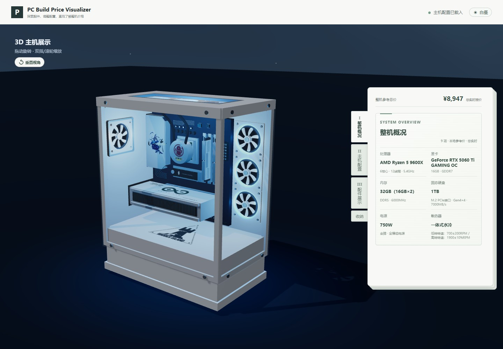
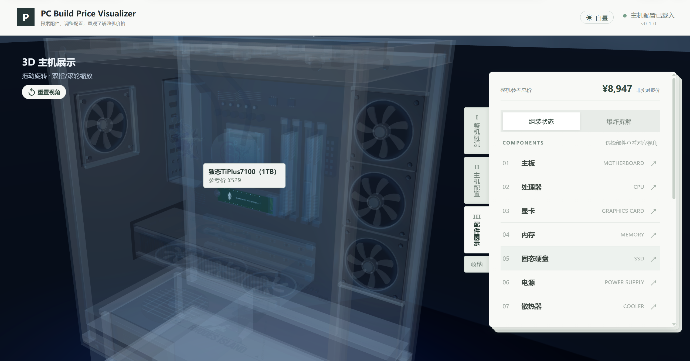
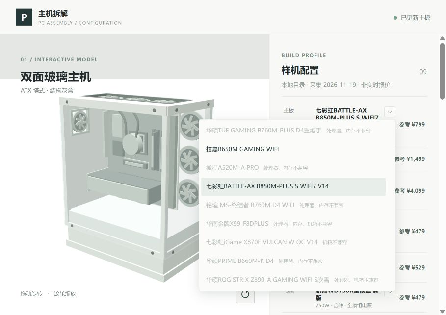
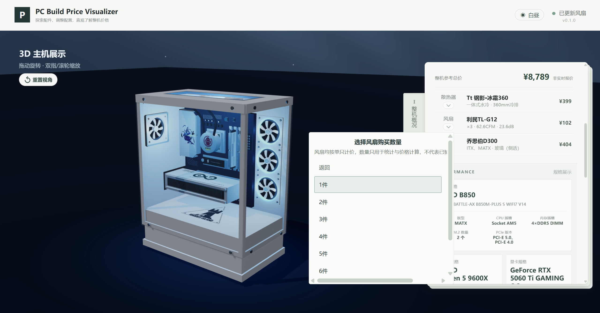
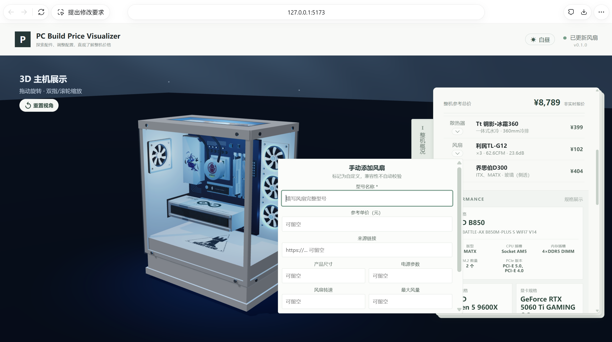
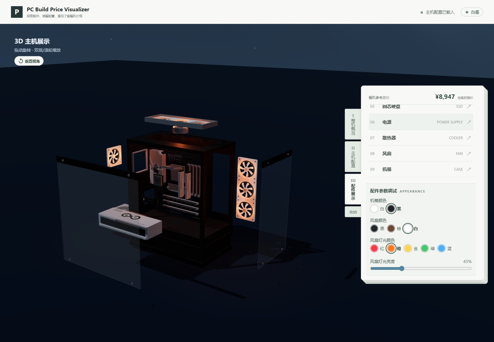
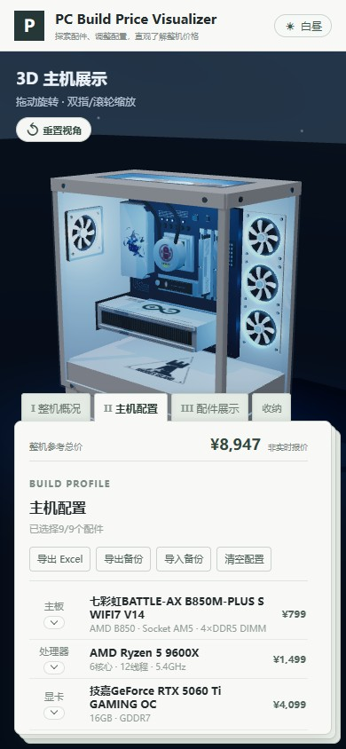

# PC Build Price Visualizer

一个面向作品集展示的 PC 装机配置与价格可视化项目。它将 Three.js 3D 主机展示、配件选择器、明确硬冲突筛选和参考价格联动组合在一个浏览器界面中，用于展示我在交互设计、数据建模和前端工程方面的实践。

## 项目亮点

- **3D 主机展示**：支持旋转、缩放、部件聚焦，以及组装和爆炸拆解视图。
- **配件选择器**：覆盖九类主要硬件，可按型号和规格搜索并即时切换。
- **兼容性筛选**：明确标记 CPU 插槽、内存规格、机箱尺寸等硬冲突，避免把缺失数据强行判断为不兼容。
- **价格与规格联动**：型号、内存数量和风扇数量变化后，整机参考价、配置摘要和规格卡同步更新。
- **本地配置管理**：支持手动添加型号、浏览器本地持久化、JSON 备份恢复和 Excel 导出。
- **工程化验证**：核心配置规则、选择器、备份恢复和数据格式均有离线测试覆盖。

## 展示截图

### 桌面端 3D 配置界面

### 配件选择器

### 兼容性选择器

### 价格与规格联动

### 本地配置管理

### 配件参数调试与 3D 效果

通过机箱颜色、风扇主体颜色、灯光颜色和灯光亮度控件，可以即时观察参数变化在 3D 主机中的呈现效果；同时支持组装状态与爆炸拆解视图切换。

### 移动端布局

## 技术栈

- Three.js
- Vite
- JavaScript、HTML、CSS
- Node.js 原生测试

## 数据与边界

项目使用本地配件目录快照进行演示，包含 9 类配件、每类 20 款，共 180 条记录。价格是采集时的参考价，不是实时电商报价；3D 模型用于表达通用品类和装配关系，不代表某个具体商品的 CAD 结构或工程尺寸。兼容性筛选只对明确的硬冲突负责，不等同于完整装机验证。

## 源码策略

这是完整项目的公开展示仓库，主要用于作品集、求职交流和功能说明。为保护求职期间的原创交互设计、数据整理方式和实现细节，完整源码、原始采集数据及内部脚本目前保存在私有仓库中，因此本仓库不提供直接运行所需的完整源码。

未来在找到合适工作，或项目获得较多关注和用户反馈后，我可能根据项目发展、数据授权和许可证安排，逐步或完全开源项目。

## 项目状态

当前公开仓库以项目介绍和界面展示为主。在线演示地址将在部署完成后补充；完整功能和最新实现保存在私有开发仓库中。

<!-- project-integrity-marker: sha256:8536b89d5fbc5348dee45ed79eddecab5e0b2dc121cfd224fa9fb16a06f551cc -->
